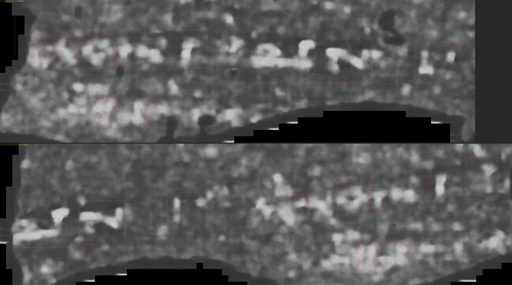
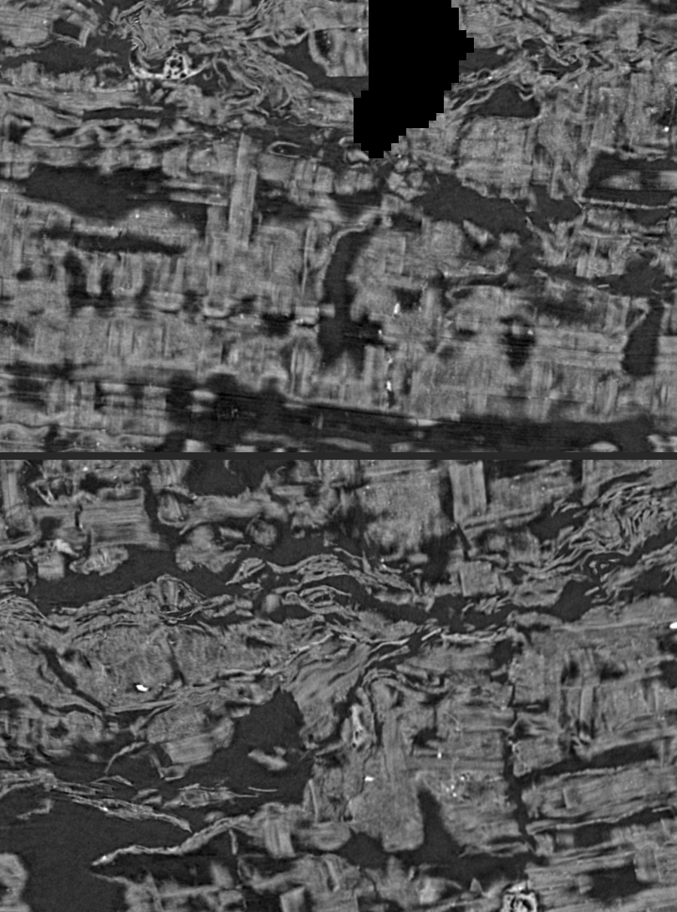
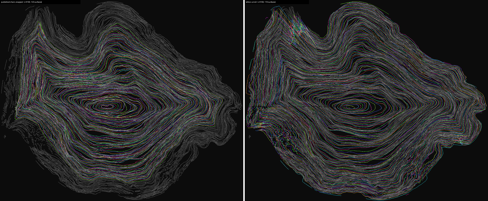
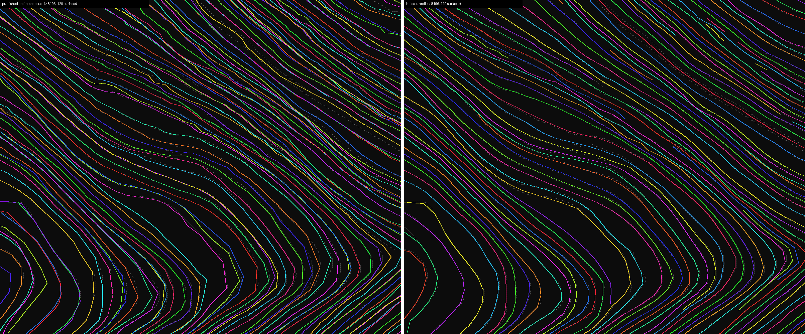
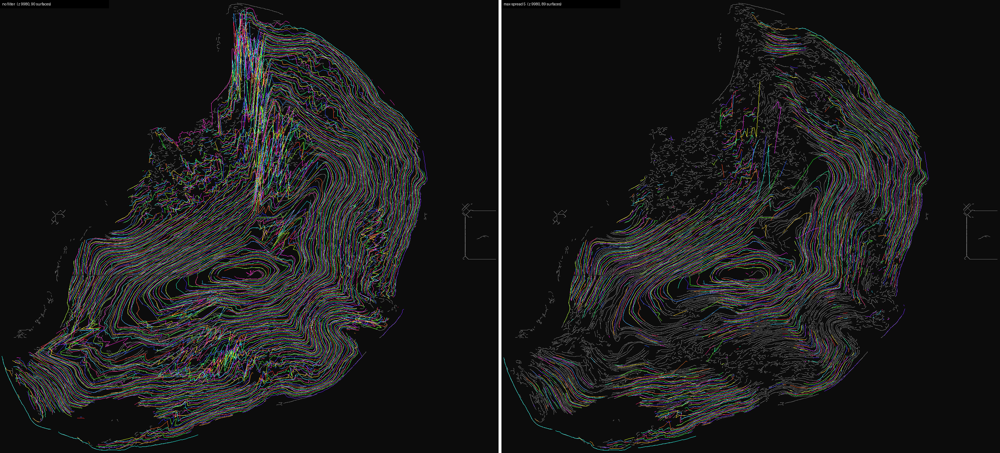

# lattice-unroll

One surface per papyrus sheet for a Herculaneum scroll, solved exactly from the public spiral-tracks
data, on a laptop, without a spiral fit and without a GPU.

Submitted to the Vesuvius Challenge Progress Prizes, November 2026.

## What it does

The spiral fitter in `villa` (`volume-cartographer/scripts/spiral`) learns a smooth field and asks it to
keep every traced sheet ("track") at one radius. That is a soft, gradient-based use of the tracks, and on
PHerc. 343 it leaves about one winding in five or six wrong: neighbouring windings land on the same sheet,
and other sheets get no winding at all.

The same tracks can be used exactly. They form a lattice over every predicted sheet:

- `h` tracks run inside z slices (every 8 voxels) and carry a sheet round the turn,
- `v` tracks run inside x and y planes and carry it along the scroll,
- where an `h` and a `v` track meet they share the same voxel.

`lattice-unroll` gives every track one whole number, its winding. A point of the track sits on winding
`number + sense * turns`, where `turns` counts how often the track has gone round the scroll axis. Votes:

| Vote | Says | Weight |
|---|---|---|
| crossing | two tracks that share a voxel are on the same winding | 8 |
| near miss | an `h` and a `v` point one step apart are on the same winding | 4 |
| next | the first other track met going outward from an `h` point is one winding further out | 1 (0.25 beyond 26 voxels) |
| order | whatever lies between, that track is at least one winding further out | 1 |

The whole numbers that break the least vote weight are found **exactly**: the cost is convex in label
differences, so repeated "move this set of tracks by k windings" steps, each one minimum cut, reach the
global minimum (the jump moves of phase unwrapping, Bioucas-Dias and Valadão 2007). About 5 percent of
tracks step to a neighbouring sheet partway along. Their crossings disagree in a run, so the track is cut
there and the problem solved again. After two such rounds 99.3 to 99.6 percent of all crossings agree.

The output is one tifxyz surface per winding (rows along z, columns round the turn), ready for the
unchanged lasagna flatten, `vc_render_tifxyz` and the public ink models.

## Results

### PHerc. 343, against the published First Letters chain (fit + snap)

Band z 9500 to 11000. Settings fixed on a tuning band (z 10000 to 10500), then scored once on held-out
data. Withheld tracks: one in ten tracks (store index mod 10 = 7) is never read by the solver.

| Measure (held-out) | Published chain | lattice-unroll |
|---|---|---|
| Sheets on a ray with exactly one surface, slice z 9700 / 10800 | 51 / 56 of about 101 | 65 / 71 |
| Sheets on a ray with two or more surfaces | 16 / 18 | 3.5 / 2.8 |
| Withheld tracks lying on one surface, z 9600 to 9950 / 10550 to 10900 | 29 % / 43 % | 32 % / 46 % |
| Long covered withheld tracks on one surface | 79 % / 66 % | 81 % / 83 % |
| Published letters within 3 voxels of one surface | 14 of 18 | 16 of 18 |
| Ink contrast at the letters (dnative, d = 0) | 1.09 | 1.04 |
| Compute | about 3 h on an RTX 4090 | 18 min on a laptop CPU |

The known line lies on one lattice surface in one piece. On the published chain's winding it is cut in
two by a change of turn, which is why the winning submission joined two windings.




### PHerc. 0175A, a clean unread scroll

Section z 7720 to 9520. The published chain was run unchanged (the PHerc. 343 recipe: fit 30,000 steps,
zero patches, snap of every winding) with the same scroll axis as lattice-unroll, so the comparison is
about the unrolling alone. Both were scored by the same script on the same slices and withheld tracks.
No settings were tuned on this scroll.

| Measure | Published chain, fitted | Published chain, snapped | lattice-unroll |
|---|---|---|---|
| Sheets on a ray reached, slice z 8200 / 9000 | 86 / 89 | 86 / 89 | 114 / 117 |
| Sheets on a ray with exactly one surface | 66 / 65 | 56 / 56 | 96 / 93 |
| Sheets on a ray with two or more surfaces | 8.4 / 8.7 | 23 / 23 | 3.4 / 3.3 |
| Withheld track points on a surface, z 8300 to 8800 | 55 % | 57 % | 86 % |
| Withheld tracks lying on one surface | 33 % | 38 % | 58 % |
| Covered withheld tracks on one surface | 91 % | 94 % | 92 % |
| Compute | 4 h 15 min on an RTX 4090 (fit 3 h 9 min) | same run | 31 min on a laptop CPU |

The fitter stops about 28 sheets short of the outside on this scroll, as it does on PHerc. 343. Where it
does reach, its snap pulls neighbouring windings onto the same sheet. Where a track is covered at all, both
methods keep it on one surface about equally often. The difference is in how much of the scroll is covered
and how often a sheet is doubled.

Cross-section at z 8200 (`lattice-xsec`): grey is every traced sheet, each colour one surface. Left the
published chain's snapped windings, right lattice-unroll. The fit leaves the outer third of the scroll
without a surface. Ours reaches the edge. Ours is wrong in the crushed fragment zone at the upper left and
in a smaller patch at the lower left.



Close-up (x 5300 to 6500, y 4500 to 5500). On the left, pairs of colours run along the same sheet (two
windings on one sheet) and leave the next sheet empty. On the right, one colour per sheet.



## Limits

- About a sixth to a third of the sheets on a ray get no surface (PHerc. 0175A: 13 to 17 percent,
  PHerc. 343: up to a third). The gain is in doubled sheets made single and in sheets the fit never
  reached.
- The scroll axis is needed. It is placed by eye at one slice (inside the innermost loop), then carried
  along the scroll by the solver itself (`march`). A fully automatic axis is not done.
- "The next track outward is the next winding" is wrong where sheets touch or fold back. On crushed parts
  of a scroll (PHerc. 0483B, part of each turn) surfaces cut across layers there. `--max-spread` removes
  such cells by how far their points sit off a flat fit. On PHerc. 0175A, a clean scroll, `--max-spread 5`
  removes 6 percent of the surface. On PHerc. 0483B it removes 48 percent (26 percent at 8): the
  zig-zags across layers in the crushed zone go, and so do jagged but partly usable stretches next to
  them. Below: PHerc. 0483B at z 9980 without the filter (left) and with `--max-spread 5` (right).

  
- Scrolls crushed into zig-zag folds with no core (PHerc. 0490B) are out of reach of this version.
- The track judge shares its tracer with the input, so it shows consistency, not truth. The independent
  checks are the known line and ink.

## Use

Needs [uv](https://docs.astral.sh/uv/) and Python 3.11 or newer. No GPU. Example: a 400-slice band of
PHerc. 343, from nothing to scored surfaces.

```bash
git clone <this repository> lattice-unroll
cd lattice-unroll
uv sync

# 1. The scroll's trace store, 9 GB for PHerc. 343. Run again to resume an interrupted download.
uv run lattice-fetch PHerc0343 stores

# 2. Look at one cross-section and pick a point inside the innermost loop (the grid is every 500 voxels).
uv run lattice-peek PHerc0343 peek.png --z 10237 --down 2

# 3. Carry the axis from that point along the band. Prints the winding sense it reads.
uv run lattice-march stores/PHerc0343 axis.json 10000 10400 march --start 5066 4321 10237 \
    --w-cross 8 --w-near 4 --split-rounds 2

# 4. Solve the band and write one surface per winding to out/s<number>/ (tifxyz).
uv run lattice-unroll stores/PHerc0343 axis.json 10000 10400 out --sense 1 \
    --w-cross 8 --w-near 4 --split-rounds 2 --tail-rel 0.0005 --row-step 20 --col-step 20

# 5. Score the surfaces on the traces the solver never read (one in ten), and draw a cross-section.
uv run lattice-withheld stores/PHerc0343 10000 10400 withheld.npz
uv run lattice-check withheld.npz out "s{:03d}" --z0 10000 --z1 10400 --only 10 7
uv run lattice-xsec stores/PHerc0343 10200 xsec.png --surfaces out "s{:03d}"
```

Formats: the input is the organisers' public spiral-tracks store (`.vctracks`) as it is published.
The output is standard tifxyz: one folder per winding with `x.tif`, `y.tif`, `z.tif` (float32, -1 where
empty) and `meta.json` (`format`, `type`, `scale`, `bbox`), the same layout as the published chain's
meshes.

On a crushed scroll add `--max-spread 5` to step 4 (see Limits). These are the settings of all results
above. Every command prints its options with `--help`. `axis.json` uses the control-point layout of the
published umbilicus files, so a published axis can be used in place of step 3. The surfaces go unchanged
into the published rendering chain (lasagna flatten, `vc_render_tifxyz`, the public ink models).

Memory and time: a 1,800-slice band of a large scroll needs about 16 GB and 20 to 30 minutes on an
M3 Pro laptop. Thinner bands need proportionally less.

## Commands

| Command | Does |
|---|---|
| `lattice-fetch` | downloads a scroll's public trace store, resumable |
| `lattice-peek` | one cross-section of a scroll from its index files and a few range requests, for choosing a scroll and placing the first axis point |
| `lattice-march` | carries the axis along the scroll from one point placed by eye |
| `lattice-unroll` | the solver: winding numbers for every trace, one surface per winding |
| `lattice-withheld`, `lattice-check` | the withheld-track judge |
| `lattice-xsec` | cross-section with surfaces drawn on it, for one or several sets of surfaces side by side |

## License

MIT for the code. The scroll data used is CC BY-NC 4.0 (Vesuvius Challenge open data).
